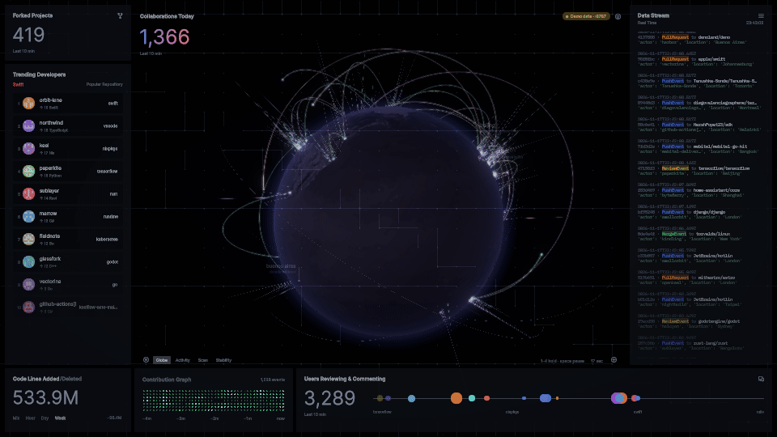
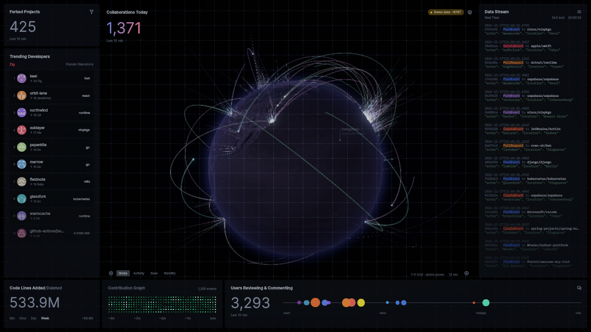
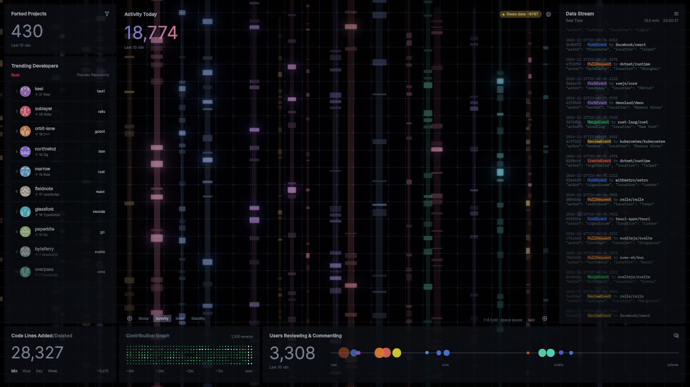
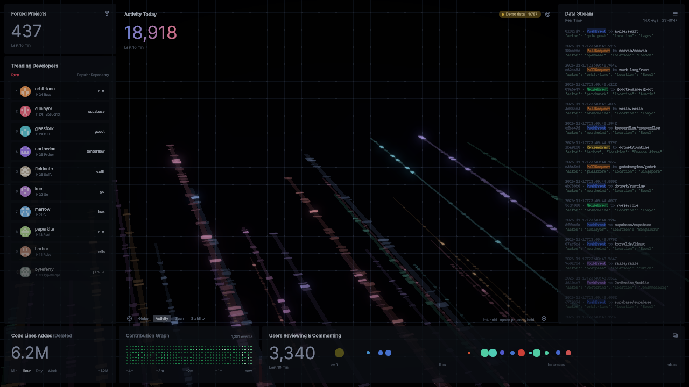
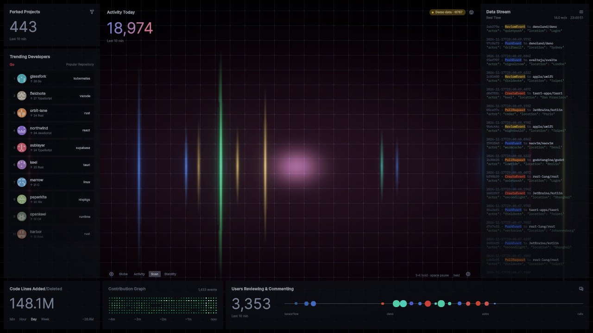
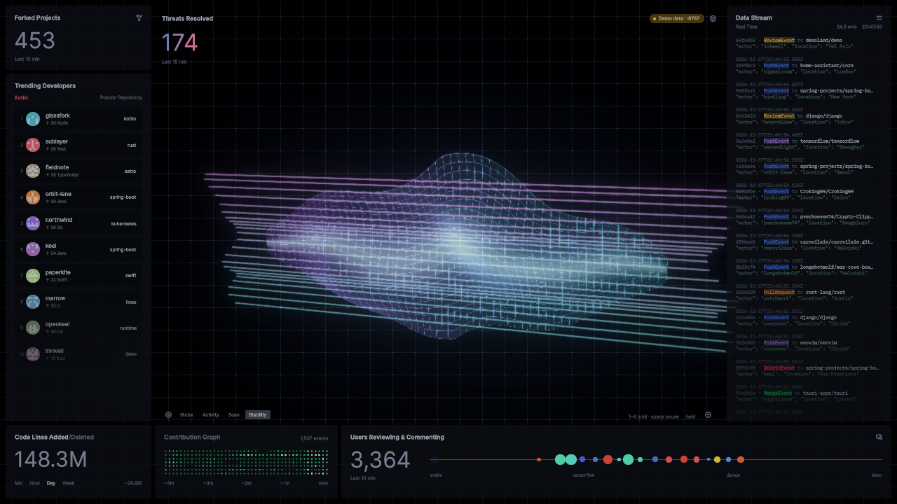

# Aegis

[](https://github.com/harmenx/aegis/actions/workflows/ci.yml)

[](LICENSE)

A real-time lobby you can drive with your own points. Each point can light a city, draw an arc, raise the activity bars, and land in the stream.



## Quick start

1. Open the project in Unity 6.6 (`6000.6.6f1`).
2. Open `Assets/Scenes/Lobby.unity` and press Play.
3. Send a point:

   ```bash
   curl -X POST http://127.0.0.1:8787/points \
     -H "Content-Type: application/json" \
     -d '{"label":"gate-3","category":"alert","place":"Singapore","targetPlace":"Sydney","hasTarget":true,"value":64}'
   ```

Until your own points arrive, a built-in demo keeps the picture moving and the status pill reads **Demo data**. The first custom point pauses the demo and the pill turns green (**Live**). Run with `demo` set to `off` to start on an empty dashboard instead (see [Configuration](#configuration)).

## Send points

Three ways in, one shape of data.

**HTTP.** While Aegis is running, `POST` to `http://127.0.0.1:8787/points`. The body can be a single point, an array of points, or `{"points":[...]}`.

**A JSON file.** Copy `points.sample.json` to `points.json`. Aegis reloads it whenever it changes and draws only the points that weren't in the previous version, so rewriting the whole file is fine. When a stream is easier, append one JSON object per line to `points.jsonl` instead.

Both files are read from the project folder in the editor, and from the folder that holds the app in a build (beside `Aegis.app` on macOS, beside `Aegis.exe` on Windows).

**C#.** From any script in the project:

```csharp
AegisFeed.Submit(new DataPoint
{
    Label = "gate-3",
    Category = "alert",
    Place = "Singapore",
    Latitude = 1.35f,
    Longitude = 103.82f,
    HasTarget = true,
    TargetPlace = "Sydney",
    TargetLatitude = -33.87f,
    TargetLongitude = 151.21f,
    Value = 64f
});
```

`AegisFeed.SubmitJson(text)` accepts the same JSON as the file and the port and returns how many points it drew. `AegisFeed.UseDemo(true)` runs your points and the built-in demo together.

## HTTP API

Requests are validated before anything is drawn, so a client always gets an answer it can act on.

| Request | Status | Body |
| --- | --- | --- |
| `POST /points`, at least one point valid | `202` | `{"accepted":2,"rejected":1,"errors":["points[2]: latitude 95 is outside -90 to 90."]}` |
| `POST /points`, every point invalid | `422` | Same shape, `accepted` is 0 |
| Body is not JSON, or not a point shape | `400` | `{"error":"Body is not valid JSON. …"}` |
| Body over `maxBodyKb`, or more than `maxPointsPerRequest` points | `413` / `400` | `{"error":"…"}` |
| More than `maxPending` points waiting to be drawn | `503` + `Retry-After: 1` | `{"error":"Aegis is behind …"}` |
| `GET /health` | `200` | `{"status":"ok","pending":0,"accepted":120,"rejected":3,"demo":false}` |
| Wrong method / unknown path | `405` / `404` | `{"error":"…"}` |

A point is rejected when a coordinate is outside its range or not a number, when `value` or `secondary` is negative, or when it has no label, place, series, id, or coordinates. Text fields are trimmed, stripped of control characters, and capped at 120 characters. Text is always shown as typed and never interpreted as markup.

Accepted points are drawn at up to `maxPointsPerFrame` per frame, so a large batch spreads over a few frames instead of stalling one. CORS is open (`*`), so a local web page can post too.

## Fields

| Field | What it does |
| --- | --- |
| `label` | Name on the callout, the stream, and the trending list |
| `series` | Group shown beside the label |
| `category` | Color and which counter moves. `alert` is red, `resolve` thickens the stability mesh, and any other word gets its own color |
| `latitude`, `longitude` | Where the point sits on the globe. A known `place` such as `Tokyo` is enough if you omit them |
| `targetLatitude`, `targetLongitude`, `targetPlace` | The other end of an arc. Set `hasTarget` when the target is exactly `0,0` |
| `value` | Bar height and lines added. Zero or more |
| `secondary` | Lines removed. Zero or more |
| `id` | Lets a rewritten `points.json` update a point instead of repeating it |

## Configuration

Copy `aegis.config.sample.json` to `aegis.config.json` beside `points.json`. Every key is optional. Environment variables override the file, and command-line arguments override both.

| Key | Default | Environment | Argument | Meaning |
| --- | --- | --- | --- | --- |
| `port` | `8787` | `AEGIS_PORT` | `-aegis-port` | HTTP port |
| `bindAddress` | `127.0.0.1` | `AEGIS_BIND` | `-aegis-bind` | `0.0.0.0` accepts other machines. There is no authentication, so only do this on a trusted network |
| `listen` | `true` | `AEGIS_LISTEN` | `-aegis-listen` | `false` turns HTTP off and leaves the files |
| `demo` | `auto` | `AEGIS_DEMO` | `-aegis-demo` | `auto` runs until the first custom point. `on` always runs it. `off` starts empty, with no demo totals |
| `githubFeed` | `true` | | | Mix public GitHub events into the demo |
| `maxBodyKb` | `1024` | | | Largest accepted request body |
| `maxPointsPerRequest` | `5000` | | | Largest accepted batch |
| `maxPending` | `20000` | | | Queue size before `503` |
| `maxPointsPerFrame` | `400` | | | Drawing budget per frame |
| `pollSeconds` | `0.4` | | | How often the points files are checked |

```bash
# A build on another port, starting empty
./Aegis.app/Contents/MacOS/Aegis -aegis-port 9000 -aegis-demo off
```

If the port is already in use, Aegis keeps running on the files. The status pill turns red and the console says which port failed and how to change it.

## Views

The buttons under the stage hold a view. Keys `1`–`4` do the same. Space pauses the cycle. Drag to orbit, and scroll to move closer.

- **Globe**: points raise tufts of fibres over their city, and arcs draw along great circles to their target, then retract. Recent places get a labelled callout.
- **Activity**: barcode columns where each point lights the top of its column, keyed by category or repo. After a few seconds the stage tips back into receding lanes.
- **Scan**: a sweep of streaks as points arrive.
- **Stability**: a mesh that thickens as resolve, review, and merge points come in.

## Screenshots

| Globe | Activity |
| --- | --- |
|  |  |
| **Lanes** | **Scan** |
|  |  |
| **Stability** | |
|  | |

## Panels

- **Status pill** shows **Live** while custom points are arriving, **Demo data** while the demo runs, and **Waiting for data** otherwise, with the HTTP port.
- **Trending Developers** ranks actors by point count, with their latest repo.
- **Data Stream** lists each point with its time, type, actor, and repo.
- **Code Lines Added / Deleted** cycles Min, Hour, Day, and Week. Min is a rolling 60 s sum of `value` and `secondary`. Click a tab to hold it.
- **Contribution Graph** has one row per event type and a column per 5 s.
- **Users Reviewing & Commenting** drifts a bubble per review across a 40 s timeline. Bubble size follows `value`.

## Project layout

```
Assets/
  Scripts/            Aegis.Runtime assembly
    Core/             Config, logging, paths, text formatting
    Data/             Point parsing and validation, HTTP intake, file feed, demo simulator
    Director/         View cycle and camera
    UI/               Dashboard overlay, one partial file per panel
    Viz/              Globe, activity barcode, scan, and stability stages
    Debug/            Headless capture and verification
  Editor/             Aegis.Editor assembly: scene builder and player build
  Tests/EditMode/     Aegis.Tests.EditMode assembly
  UI/                 UXML layout and USS styles
  Shaders/            Aegis/* shaders
```

## Development

**Tests.** Run them from *Window → General → Test Runner → EditMode*, or headless:

```bash
Unity -batchmode -projectPath . -runTests -testPlatform EditMode -testResults Logs/editmode-results.xml
```

**Headless check.** This rebuilds the scene from code, plays each view, and writes `playback-report.txt` with PASS or FAIL, plus `playback-*.png` captures. Unity can hang on exit after the report is written, so stop it once the report appears. Touch `gif-record.flag` first to also dump 36 frames to `gif-frames/` for the preview.

```bash
Unity -batchmode -projectPath . -executeMethod Aegis.Editor.ProjectSetup.BuildAndVerify -logFile Logs/verify.log
```

**Player builds.** *Aegis → Build Player* builds the active target into `Builds/<target>/`. From the command line:

```bash
Unity -batchmode -quit -projectPath . -buildTarget StandaloneOSX -executeMethod Aegis.Editor.PlayerBuild.Build
```

### Continuous integration

`.github/workflows/ci.yml` runs on every push and pull request. It checks that every asset has its `.meta` file and that the JSON files parse. When a Unity licence is configured, it also runs the EditMode tests and builds Windows, Linux, and macOS players as downloadable artifacts.

To turn on the Unity jobs, add the `UNITY_LICENSE`, `UNITY_EMAIL`, and `UNITY_PASSWORD` repository secrets (see [GameCI activation](https://game.ci/docs/github/activation)). Without them those jobs are skipped, not failed.

### Local files

`github.token` at the project root is only used by the demo's public GitHub feed. It stays out of git, and so do `points.json`, `points.jsonl`, and `aegis.config.json`.

## License

MIT, see [LICENSE](LICENSE). The dashboard is set in Inter, with IBM Plex Mono for the data stream. Both are included under the SIL Open Font License.
