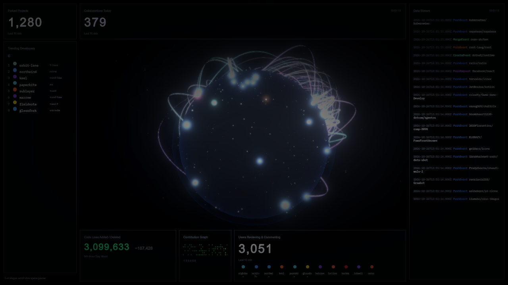

# Aegis

A real-time lobby you can drive with your own points. Each point can light a city, draw an arc, raise the activity bars, and land in the stream.



Unity 6.6 (`6000.6.6f1`). Open the project and press Play on `Assets/Scenes/Lobby.unity`.

Until your own points arrive, a built-in demo keeps the picture moving. The first custom point pauses that demo.

## Send points

Three ways in, one shape of data.

**A JSON file.** Copy `points.sample.json` to `points.json` in the project folder. Aegis reloads it when the file changes. Points with the same id and values are not drawn twice. Append one JSON object per line to `points.jsonl` when a stream is easier than rewriting the whole file.

**HTTP.** While the lobby is playing, post to `http://127.0.0.1:8787/points`:

```bash
curl -X POST http://127.0.0.1:8787/points \
  -H "Content-Type: application/json" \
  -d '{"label":"gate-3","series":"arrivals","category":"alert","place":"Singapore","latitude":1.35,"longitude":103.82,"value":64}'
```

A single object, a raw array, or `{"points":[...]}` all work.

**C#.** From any script in the project:

```csharp
AegisFeed.Submit(new DataPoint
{
    Label = "gate-3",
    Series = "arrivals",
    Category = "alert",
    Place = "Singapore",
    Latitude = 1.35f,
    Longitude = 103.82f,
    HasTarget = true,
    TargetPlace = "Sydney",
    TargetLatitude = -33.87f,
    TargetLongitude = 151.21f,
    Value = 64f
});
```

`AegisFeed.SubmitJson(text)` accepts the same JSON as the file and the port. `AegisFeed.UseDemo(true)` runs your points and the built-in demo together.

## Fields

| Field | What it does |
| --- | --- |
| `label` | Name on the callout, the stream, and the trending list |
| `series` | Group shown beside the label |
| `category` | Color and which counter moves. `alert` is red, `resolve` thickens the stability mesh, and any other word gets its own color |
| `latitude`, `longitude` | Where the point sits on the globe. A known `place` such as `Tokyo` is enough if you omit them |
| `targetLatitude`, `targetLongitude`, `targetPlace` | The other end of an arc. Set `hasTarget` when the target is exactly `0,0` |
| `value` | Bar height and lines added |
| `secondary` | Lines removed |
| `id` | Lets a rewritten `points.json` update a point instead of repeating it |

## Views

The buttons along the top hold a view. Keys `1`–`4` do the same. Space starts the cycle again. Drag to orbit, and scroll to move closer.

- **Globe** — points, arcs, and ray bursts
- **Activity** — a column for each category
- **Scan** — a sweep as points arrive
- **Stability** — a mesh that thickens as resolve, review, and merge points come in

`github.token` at the project root is only used by the demo's public GitHub feed. It stays out of git, and so do `points.json` and `points.jsonl`.

The dashboard is set in IBM Plex Mono, which is included under the SIL Open Font License.
